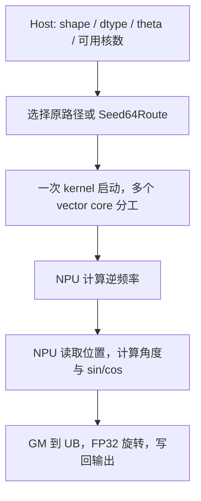

# 从计算到实现

## 先看一个 token

假设 `D=4`，输入为 `[a,b,c,d]`。本题把前后两半配对，即 `(a,c)`、`(b,d)`。对第 i 对维度，用位置 p 乘以逆频率得到角度：

```text
inv_freq[i] = 1 / theta^(2*i/D)
angle[i] = p * inv_freq[i]
y[i]       = x[i] * cos(angle[i]) - x[i+D/2] * sin(angle[i])
y[i+D/2]   = x[i+D/2] * cos(angle[i]) + x[i] * sin(angle[i])
```

D=4 只是解释配对的小例子，题目实际要求 D 为 16–1024 的偶数。同一 token 的多个 head 使用相同的 p 和频率，因此可以共用三角系数。

输入是连续 ND 张量 `x[B,S,H,D]`（FP16/FP32）与 `positions[B,S]`（int32），输出与 x 的形状、类型相同。题面范围 B=1–128、S=1–8192、H=1–256；默认 theta=10000。这里按历史题面整理，精度说明存在两个口径，详见[验证说明](validation.md)。

## Host 与 NPU 的分工



Host 不读取张量值来计算频率或旋转。最终文件有多处静态 launch 语句，dtype、数学适用域和布局分支互斥，每次实际调用走一条完整 kernel 路径；静态语句数量不等于实际启动次数。

## 为什么频率精度重要

`angle = position * inv_freq`。位置很大时，逆频率中的小误差会放大为角度误差，最终影响 sin/cos。v3 在 NPU 用 `RotaryFloatPair{hi,lo}` 保存 FP32 加、乘、除的舍入残差，通过 log/exp 计算幂，再按 FP32 舍入并取倒数。

这增加了标量计算成本，后续实现进一步使用比率复用、Horner 路径及有适用域的向量频率生成。它们都要保持与参考实现的指数、幂、倒数舍入关系；不能把实数数学等价直接当成浮点等价。最终 Seed64Route 中的 64 种子与倍增路径对靠近舍入边界的项保留标量修复。

这是一套实现选择，平台 15 点通过是有限证据；本项目没有给出全部合法参数上的严格误差证明。

## 从逐 head 搬运到分块与缓存

v3 的阅读路径是 `run_kernel → rotary_pos_emb_custom → Init/Process`。最终实现围绕以下成本组织数据：

- **多核分组**：将 B×S 个 token 划为连续组，核间输出边界按 32 字节对齐；组索引和 GM 偏移使用 64 位计算。
- **head 分块**：一次处理多个 head，减少小块 DMA 与队列操作；非对齐维度用 padding/gather，写出仅覆盖真实元素。
- **三角系数复用**：一个 token 的系数给多个 head 使用；部分路径再按 UB 预算批量缓存多个 token 的角度和三角函数。
- **token window**：把若干完整 token 的搬运、转换和旋转组织成一批，以 repeat/stride 复用指令调度。行数同时受 UB、shape、核分工和 repeat 表达范围约束。

队列、临时 buffer、对齐空洞和高级 API scratch 都消耗 UB。代码按 192 KiB 预算计算部分路径的容量，并预留 API 空间；这一预算是当前实现的环境假设，不能替代其他设备的运行验证。

有双槽队列或预取代码并不自动证明发生了搬运与计算重叠。没有对应 profile/汇编证据时，只描述代码结构和实际平台反馈，不宣称已测得具体 overlap 或带宽利用率。

## 特殊值与同步

位置为 0 时按位复制输入，避免将 `Inf*0` 或 NaN 传播引入本应不旋转的输出，也保留负零和 NaN 原始编码。非零位置按旋转语义处理特殊值；FP16 输出修复依赖向量比较、选择和位表示，避免默认 Cast 饱和行为改变 NaN/Inf 分类。

不同路径用 TQue 或显式事件管理搬运与计算边界，使用 V_S/S_V 和向量 barrier 处理标量、矢量之间的数据依赖。阅读时要分别追踪“谁写 buffer、谁接着读、何时允许复用”，不能随意删等待。

## 最终代码定位

以下均为 `final/kernel.asc` 的原始行号，便于搜索，不修改源码以追求排版：

| 入口或符号 | 原始行号 | 阅读目的 |
| --- | ---: | --- |
| RotaryFloatPair / PairAdd / PairMul | 9 起 | 补偿 FP32 算术 |
| RotaryRepairHalf | 241 起 | FP16 特殊值修复 |
| RotaryPackedSdkTrig | 395 起 | 参考 SDK 的三角计算序列 |
| RotaryPosEmbBaseline::Init | 546 起 | 分工、head 分块与 UB 配置 |
| RotaryPosEmbBaseline::Process | 684 起 | 频率生成与 token 遍历 |
| ComputeAngleCache | 912 起 | 核内多 token 系数缓存 |
| RotaryHalfTokenWindow / RotaryFloatTokenWindow | 2855 / 3101 起 | 批量 token 的布局与 repeat |
| namespace Seed64Route | 3341 起 | 与原设备路径隔离的频率实现 |
| RotarySeed64Frequency | 3930 起 | NPU 生成种子、倍增与舍入边界修复 |
| run_tree_route | 6806 起 | 选择 Seed64Route 下的完整 kernel |
| run_kernel | 6895 起 | Host 总入口与数学适用域 |

最终文件约 7000 行，其中存在隔离设备路径所保留的重复代码。先读 v3 的完整流程，再追一个最终分支，比一次理解全部类更合适。重复保留有历史实验背景，本次提取没有重构它，也没有宣称它是通用 RoPE 库的最佳结构。
